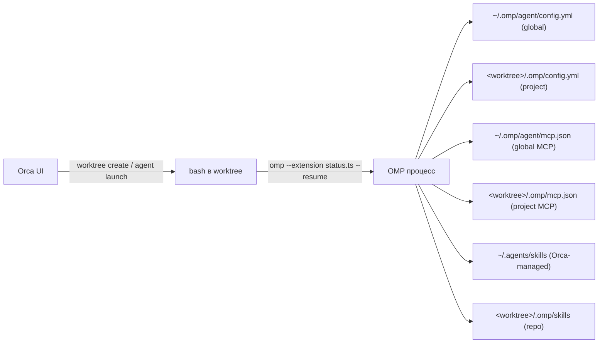

# OMP 19.1 на Debian 13 + Orca: заметки по настройке

Дата: 2026-11-22. Машина: Debian 13.7 (trixie), ext4, kitty, OMP 19.1.0, Orca 1.4.268.
Статус: **план**. В `~/.omp/agent/config.yml` ничего не применено.

---

## 1. Кто владеет чем (главное)

Orca — не оболочка конфигурации, а **лаунчер и UI**. Она запускает бинарь `omp` в терминале рабочего дерева и добавляет своё окружение. Конфиг, MCP, скиллы, агенты, роли моделей принадлежат OMP.

Фактическая команда запуска (снята с живого процесса):

```
omp --extension ~/.omp/agent/extensions/orca-agent-status.ts \
    --resume ~/.omp/agent/sessions/<encoded-cwd>/<session>.jsonl
```

Окружение, которое Orca выставляет (проверено в живой сессии):

| Переменная | Значение | Смысл |
|---|---|---|
| `ORCA_OMP_SOURCE_AGENT_DIR` | `~/.omp/agent` | откуда Orca берёт конфиг при создании управляемого |
| `ORCA_OMP_STATUS_EXTENSION` | `.../extensions/orca-agent-status.ts` | status-хук, который Orca подключает через `--extension` |
| `ORCA_OMP_FRESH_CONFIG` | `~/.config/orca/omp-managed-status-extension/fresh-session.yml` | overlay для нового терминала (`autoResume: false`) |
| `ORCA_OMP_PREFILL` | (появляется при запуске с промптом) | текст, который расширение кладёт в редактор |
| `ORCA_OMP_CODING_AGENT_DIR` | **не выставлена** | опциональный override каталога агента; лаунчер её уважает |

Вывод: `omp config path` = `~/.omp/agent` — общий на все воркспейсы и воркtree. Orca ничего не изолирует по умолчанию.



---

## 2. Куда что ставить

| Что | Где источник истины | Путь | Коммитить? |
|---|---|---|---|
| MCP, общие для машины | OMP | `~/.omp/agent/mcp.json` | нет |
| MCP, специфичные для репо (DSN, локальные пути) | OMP | `<repo>/.omp/mcp.json` | да, но без секретов |
| Скиллы Orca (orca-cli, orchestration, jira, linear, plugin-authoring, emulator) | **Orca** | `~/.agents/skills` (+ линки в папки агентов) | нет |
| Свои скиллы для проекта | OMP | `<repo>/.omp/skills/<name>/SKILL.md` | да |
| Свои скиллы на все проекты | OMP | `~/.omp/agent/skills/<name>/SKILL.md` | нет |
| Сабагенты проекта | OMP | `<repo>/.omp/agents/*.md` | да |
| Сабагенты на все проекты | OMP | `~/.omp/agent/agents/*.md` | нет |
| Настройки проекта (роли, approval, LSP) | OMP | `<repo>/.omp/config.yml` | да |
| Личные настройки | OMP | `~/.omp/agent/config.yml` | нет |
| Секреты, API-ключи | OMP | приватные файлы агента: `config.yml`, `agent.db` (0600); опционально `.env` / `secrets.yml` | нет |
| Keybindings | OMP | `~/.omp/agent/keybindings.yml` | нет |
| Плагины/расширения Orca | Orca | `~/.config/orca/...` | нет |

Права файлов (проверено `stat` на этой машине): `config.yml` и `agent.db` — 0600, `history.db` — 0644, каталог `sessions/` — 0775 с файлами 0664. То есть история сессий, заголовки и recap-индекс читаются любым локальным пользователем. Если это нежелательно: `chmod 700 ~/.omp/agent ~/.omp/agent/sessions` и `chmod 600 ~/.omp/agent/history.db*`. Файлов `.env` и `secrets.yml` здесь нет: секреты приходят из env-каскада (`.env` подхватывается, если создан) и/или лежат в `agent.db`.

Оркестрация — два разных слоя, не смешивать:

- **Orca**: воркtree, параллельные агенты, relay на телефон, handoff, `orca orchestration` (см. skill `orchestration`).
- **OMP**: `task`-сабагенты внутри одной сессии (см. `omp://tools/task.md`).

---

## 3. Следствия работы в worktree

1. Orca создаёт отдельный checkout на задачу → **проектный конфиг должен быть в git**, иначе новый воркtree его не увидит.
2. OMP ищет `<cwd>/.omp/config.yml` **без подъёма по родителям**. Запуск из подкаталога = проектные настройки не применились. Skills/AGENTS.md при этом ищутся вверх — асимметрия.
3. Массивы в YAML **заменяются**, а не сливаются: проектный `disabledProviders`/`enabledModels`/`cycleOrder`/`extensions` стирает глобальный список.
4. `modelRoleStorage: project` → роли пишутся в `<repo>/.omp/config.yml` (иначе в глобальный).
5. Общий MCP-процесс: OMP шарит stdio-сервер по `command+args+cwd+env`. Для серверов, не зависящих от проекта, задать `cwd` = домашний каталог — один процесс на все воркtree. Иначе — процесс на каждый worktree.
6. `isolation.backend: rcopy` (ext4): изоляция сабагентов = полная копия, дорого на больших репо.

---

## 4. MCP

Orca своего MCP-реестра для OMP не имеет (в CLI нет `mcp`; строки `mcpServers` в бандле относятся к переносу настроек Claude). Ставить только в OMP.

- Глобально: `~/.omp/agent/mcp.json`, серверы с `cwd` = домашний каталог.
- Проектно: `<repo>/.omp/mcp.json` — только реально репозиторные (postgres DSN, локальные пути), в git.
- `disabledServers`/`enabledServers` читаются **только** из юзерского файла активного профиля.
- Не ставить: `filesystem`, `fetch`, `sqlite`, `memory`, `sequential-thinking`, `playwright` — закрыты нативно; браузерные MCP ещё и молча выбрасываются при `browser.enabled: true`.
- `mcp.startupTimeoutMs: 1000` — холодный `npx`/`uvx` не успевает за 250 мс.
- Проектный `.omp/mcp.json` — исполняемый код (stdio запускает команду). Для чужих репо: `mcp.enableProjectConfig: false` или отдельный профиль.

Минимум: `context7` (HTTP) и `postgres` (uvx), если нужны.

```json
// ~/.omp/agent/mcp.json
{
  "$schema": "https://raw.githubusercontent.com/can1357/oh-my-pi/main/packages/coding-agent/src/config/mcp-schema.json",
  "mcpServers": {
    "context7": {
      "type": "http",
      "url": "https://mcp.context7.com/mcp",
      "headers": { "Authorization": "Bearer ${CONTEXT7_API_KEY}" }
    }
  },
  "disabledServers": ["filesystem", "memory", "sequential-thinking", "fetch", "playwright"]
}
```

---

## 5. Скиллы и плагины

Два источника, оба видны OMP:

| Источник | Кто пишет | Как обновлять |
|---|---|---|
| Orca bundled (`orca-cli`, `orchestration`, `orca-jira`, `orca-linear`, `orca-plugin-authoring`, `orca-emulator*`, `orca-per-workspace-env`, `jira-tickets`, `linear-tickets`) | `orca skills install` | `orca skills update`; изменённые вручную копии пропускаются |
| Свои | вы | git / вручную |

`orca skills install` кладёт копию в `~/.agents/skills` и линкует в папки обнаруженных агентов; `--local` — в проект (только если у проекта уже есть папка агента); `--agent universal` — только общая папка. В этой сессии OMP видит 5 скиллов из `~/.agents/skills` напрямую.

Правила:

- Orca-скиллы не редактировать: `--force` заменит, старая копия уйдёт в `~/.agents/.orca-skill-backups`.
- Свои проектные — в `<repo>/.omp/skills/<name>/SKILL.md` (ровно один уровень вложенности), коммитить → наследуются всеми воркtree.
- Реестр `skills.omp.sh` на 2026-11-22 пуст (0 пакетов): `omp skill install` не даст ничего. Авторить локально.
- Hooks — только TS/JS в `.omp/hooks/pre|post/`; shell/Python-хуки чужих плагинов не исполняются.

---

## 6. Чек-лист

### Фаза 0 — база

- [ ] `cp ~/.omp/agent/config.yml ~/.omp/agent/config.yml.bak-$(date +%F)`
- [ ] `omp config path` → `~/.omp/agent`; `omp --version` ≥ 19.1.0
- [ ] Запускать из корня проекта (проектный конфиг не поднимается по родителям)
- [ ] Для чужих репо: `omp --profile untrusted --alias omp-u`

### Фаза 1 — безопасность

- [ ] `tools.approvalMode: write` (сейчас `yolo`, проверено `omp config get`)
- [ ] `tools.restrictedFolders`: `~/.ssh`, `~/.gnupg`, `~/.aws`, `~/.kube`, `~/.config/gh`, `~/.password-store`, `~/secrets`
- [ ] `bash.patterns` — точечные `deny`/`prompt`
- [ ] НЕ ставить `tools.approval.bash: prompt` / `eval: prompt`: сабагенты headless, `prompt` у них = отказ
- [ ] `secrets.enabled: true`
- [ ] `providers.webKeyless: false` (иначе keyless Parallel)
- [ ] `mcp.enableProjectConfig: false` для недоверенных чекаутов

### Фаза 2 — UX

- [ ] `display.showTokenUsage: true`; `composer.predictions: false`
- [ ] `tui.mouse: false`, `tui.maxFps: 30`
- [ ] `terminal.showImages: true`, `tui.textSizing: true` (kitty)
- [ ] Keybindings — только `~/.omp/agent/keybindings.yml`
- [ ] `EDITOR` задан; `wl-clipboard` установлен (Wayland-вставка картинок)

### Фаза 3 — модели

- [ ] `/model → Roles`: `default`, `smol`, `slow`, `task`, `commit`, `tiny`
- [ ] `judge` требует нативного бэкенда; на `cline-pass` его нет → `prewalk.auto` и `autoParallel` не включать
- [ ] `retry.fallbackChains` для `default`/`smol`/`task`
- [ ] Compaction — дефолт (`keepRecentTokens: 20000`)

### Фаза 4 — MCP

- [ ] Только `context7` / `postgres-mcp` по потребности
- [ ] `cwd` = домашний каталог для проектно-независимых серверов
- [ ] `mcp.startupTimeoutMs: 1000`
- [ ] `/mcp list`, `/mcp test <name>`

### Фаза 5 — агенты

- [ ] `task.maxConcurrency: 6` (8 ядер), `workerThreads: 0`
- [ ] `task.softRequestBudget: 150`, `showResolvedModelBadge: true`
- [ ] `isolation.backend: rcopy`, `task.isolation.enabled: true`
- [ ] `worktree.clone: false` (ext4)
- [ ] Свои агенты — `.omp/agents/*.md` в репо (коммитить)
- [ ] `advisor.enabled: false` пока; позже `reviewMode: agent-end`

### Фаза 6 — скиллы/плагины

- [ ] `orca skills install --dry-run` → затем `--all` (Orca-скиллы в `~/.agents/skills`)
- [ ] Свои проектные скиллы — `.omp/skills/`, проверить `omp skill list . --json`
- [ ] Плагины — только при необходимости: `omp plugin marketplace add ...`
- [ ] Hooks — как второй слой, не песочница

### Фаза 7 — LSP/шелл

- [ ] `apt install clangd gopls rust-analyzer python3-pylsp fuse-overlayfs`
- [ ] `npm i -g typescript typescript-language-server pyright bash-language-server yaml-language-server`
- [ ] `lsp.formatOnWrite: false`, `lazy: true`, `shared: true`; pyright → `lazy: false`
- [ ] `lsp.enabled: false` не выключает LSP из write/edit — только `--no-lsp`
- [ ] `bash.direnv: auto`, `gitGuard: true`
- [ ] `omp worktree clear` периодически

### Фаза 8 — проверка

```bash
omp config get tools.approvalMode
omp config get isolation.backend
omp models --kind chat | head
/mcp list ; /agents ; /hotkeys ; /advisor status
omp skill list . --json
orca skills installed --json
```

---

## 7. Конфиг (слить с текущим, не перезаписывать)

```yaml
tools:
  approvalMode: write
  restrictedFolders:
    - ~/.ssh
    - ~/.gnupg
    - ~/.aws
    - ~/.kube
    - ~/.config/gh
    - ~/.password-store
    - ~/secrets

bash:
  gitGuard: true
  direnv: auto
  patterns:
    - { match: "sudo *", approval: prompt }
    - { match: "systemctl *", approval: prompt }
    - { match: "git push --force*", approval: prompt }
    - { match: "rm -rf /*", approval: deny }
    - { match: "dd * of=/dev/*", approval: deny }
    - { match: "mkfs*", approval: deny }
    - { match: "curl * | sh*", approval: deny }

secrets:
  enabled: true

providers:
  webKeyless: false

modelRoles:
  default: cline-pass/deepseek-v4.1-flash-1017
  smol: cline-pass/minimax-m3.1-flash      # сверить: omp models --kind chat
  slow: cline-pass/deepseek-v4-pro
  task: "@smol"
  commit: "@smol"
  tiny: "@smol"

retry:
  enabled: true
  modelFallback: true
  fallbackChains:
    default: [cline-pass/deepseek-v4-pro]
    smol: [cline-pass/deepseek-v4.1-flash-1017]

task:
  maxConcurrency: 6
  workerThreads: 0
  softRequestBudget: 150
  showResolvedModelBadge: true
  isolation:
    enabled: true
    merge: patch
    apply: true

isolation:
  backend: rcopy

worktree:
  base: ~/worktrees
  clone: false

lsp:
  lazy: true
  formatOnWrite: false
  diagnosticsOnEdit: false

display:
  showTokenUsage: true

composer:
  predictions: false

mcp:
  startupTimeoutMs: 1000
```

---

## 8. Не делать

| Не делать | Почему |
|---|---|
| Искать MCP-настройки в Orca | их нет; Orca только запускает `omp` |
| Редактировать `~/.agents/skills/orca-*` | Orca перезапишет (`--force`) или пропустит копию |
| `tools.approval.bash: prompt` глобально | headless-сабагенты не могут ответить → отказ |
| `isolation.backend: reflink`/`overlayfs` без fuse | ext4, overlay не смонтирован |
| `lsp.formatOnWrite: true` | массовый reformat при каждом write |
| `tui.mouse: true` | ломает скролл колесом |
| `compaction.strategy` | ключа нет (блоги под omp 16.x) |
| Проектный `.omp/config.yml` вне git | новый воркtree Orca его не получит |

---

## 9. Оркестрация: Orca и OMP

Orca не «крутит OMP внутри себя». Она поднимает **отдельные процессы OMP** в отдельных worktree и связывает их сообщениями. Внутри одного процесса живёт только OMP-слой сабагентов.

### Три уровня

| Уровень | Единица | Кто создаёт | Изоляция |
|---|---|---|---|
| Workspace / worktree | checkout + ветка + терминалы | `orca worktree create` | свой каталог, свой OMP |
| Supervised worker | Run → Task → Dispatch → терминал | `orca orchestration worker-start` | свой worktree + процесс |
| OMP-сабагент | `task`-вызов | сам OMP | общий процесс, общий checkout |

Термины: **Run** — namespace и домашний inbox; **Task** — единица работы; **Dispatch** — конкретный запуск у воркера; **Worker** — агент в своём worktree. Всё это живёт в Orca.

### Спавн

`orca worktree create --agent omp` делает checkout от базовой ветки, запускает `omp` в терминале каталога и передаёт промпт. Для нового запуска промпт идёт через launch journal, а `orca-prefill.ts` кладёт его в редактор OMP через `ORCA_OMP_PREFILL`.

Handoff (ничего не ждём, исходный агент останавливается):

```bash
orca worktree create --name fix-race --agent omp \
  --surface terminal --prompt "$(cat brief.md)" --json
```

Supervised worker (ждём результат):

```bash
orca orchestration run-create --objective "починить гонку в keygate" --json
orca orchestration task-create --spec-file brief.md --task-title fix-race --json
orca orchestration worker-start --environment local \
  --spec-file brief.md --worktree new-child --name fix-race \
  --agent omp --model "@slow" --json
# закончить ход; Orca разбудит на worker_done / question / escalation
```

`--worktree`: `current` — ваш checkout (конфликты правок), `new-child` — вложенный, `new-top-level` — независимый.

### Сообщения

Тело сообщения **не печатается** в терминал воркера: Orca будит его заметкой, воркер забирает почту сам.

```bash
orca orchestration send --to dispatch:<id> --subject "уточнение" --body-file msg.md --json
orca orchestration check                  # FIFO-батч, помечает прочитанным
orca orchestration check --wait --timeout-ms 300000
orca orchestration check --peek --format  # посмотреть, не забирая
orca orchestration reply --id <message_id> --body "ответ"
```

- Доставка ровно один раз: при потере ответа — `operationId` / `--retry-request`, не новый запуск.
- `worker_done` закрывает Task; провал не помечается выполненным.
- `escalation` + `stopReason` — воркер остановился без отчёта; `exited`/`lost` — процесс исчез.

### Наблюдение

```bash
orca agent list --json
orca agent read <id> --json              # транскрипт, не экран
orca terminal read --terminal <h> --screen --json
orca terminal wait --terminal <h> --for tui-idle --timeout-ms 300000
orca orchestration worker-list --json
orca orchestration inbox --terminal run:<run_id> --limit 50
```

`tui-idle` работает для OMP благодаря `orca-agent-status.ts`, подключённому через `--extension`. Без отчётов статуса Orca держит почту неотданной.

### Когда что

| Ситуация | Инструмент |
|---|---|
| Параллельные ветки и фиксы в разных worktree | Orca workers |
| Нужен другой агент (Codex/Claude/Pi) или другая машина | Orca workers |
| Долгая задача + relay на телефон | Orca |
| Разведка по репозиторию, read-only скауты | OMP `task` |
| Параллельные правки в одном репо с изоляцией | OMP `task` + `isolated: true` |
| Один связный рефакторинг | одна сессия |

Двойная оркестрация (Orca-воркер, спавнящий OMP-сабагентов) законна, но дорога: каждый уровень умножает расход и усложняет атрибуцию ошибок.

### Ловушки

- Не поллить: скрипт с `check` съедает почту, и Orca нечем будить координатора. Завершили ход — Orca разбудит.
- Спящий терминал нельзя адресовать; почта в живой терминал не durable.
- `terminal send` для общения с агентом запрещён — только `orchestration send`.
- ~4 воркера одновременно, остальные по мере возврата.
- `worker-start` не проверяет наличие CLI: отсутствующий бинарь даёт `agent_readiness` timeout.
- Авторетраев нет; «тишина» не доказывает остановку процесса.
- Меню доверия/разрешений в OMP блокирует промпт с Enter (`agent_prompt_blocked`) — его закрывает человек.
- OMP практичнее держать в `--surface terminal`; `--model` принимает и роли OMP (`@slow`, `@smol`).

---

## 10. HTML-вики

`docs/wiki/index.html` — офлайн-вики без зависимостей: сайдбар, TOC, поиск (Ctrl+K), тёмная/светлая тема, интерактивный чек-лист с сохранением в localStorage, SVG-схемы. Открывается напрямую из файловой системы.

---

## 11. Источники

- `omp://settings.md`, `omp://mcp-config.md`, `omp://skills.md`, `omp://task-agent-discovery.md`, `omp://approval-mode.md`, `omp://config-usage.md`
- `cfg://` — фактические дефолты этой сборки
- Orca CLI 1.4.268: `orca skills get orca-cli`, `orca skills install --help`, `orca agent installed --json`, `orca worktree list --json`
- Запуск и окружение OMP: `/proc/<pid>/cmdline`, `/proc/<pid>/environ` живого процесса
- https://james-carr.org/posts/2026-09-30-current-agentic-development-setup-orca-oh-my-pi/ — «OMP is the harness, Orca is where I run many of them»
- https://james-carr.org/posts/2026-10-02-building-your-own-advisors-in-oh-my-pi/
- GH can1357/oh-my-pi#18407 (sandbox отсутствует), #18205 (lsp.enabled ≠ off), #7316 (Wayland clipboard)
- https://www.reddit.com/r/PiCodingAgent/comments/1xy7ovw/ (keyless Parallel, 2026-11-17)

Не проверено вживую: запуск MCP-серверов, установка LSP, `omp plugin install`, `orca skills install --all`.
